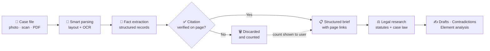
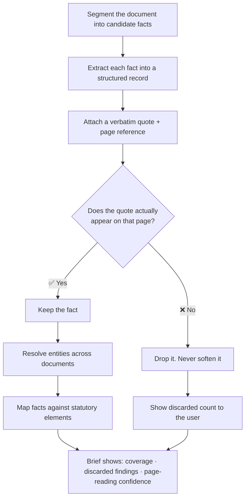
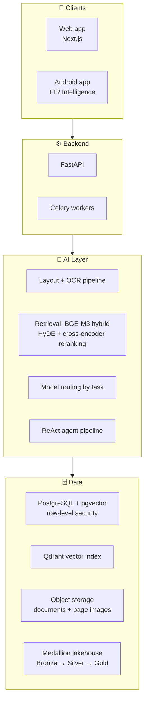
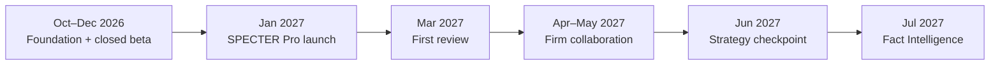

# SPECTER

### ⚖ Legal Intelligence for Pakistani Lawyers

*"Justice should never be lost to a precedent no one had time to find."*

 

 

**[The Problem](#the-problem) · [Features](#features) · [How It Works](#how-it-works) · [Benefits](#who-benefits-and-how) · [Tech Stack](#technology-stack) · [Roadmap](#roadmap) · [Team](#team)**

<!--
  OPTIONAL: add a hero banner or product screenshot here once available, e.g.
  

-->

---

## Overview

**SPECTER is an AI assistant that reads, understands and researches Pakistani legal material the way a diligent junior associate would, but in seconds.**

A lawyer uploads a case file (typed documents in Urdu or English) and SPECTER turns it into a structured brief where every fact links back to the exact page it came from. It also answers legal research questions with citations, drafts documents, and keeps the lawyer ahead of court dates.

> [!IMPORTANT]
> **The idea behind SPECTER:** every legal AI product in Pakistan tells you what it can do. **SPECTER tells you how often it is right, and shows you the page.**

<b>📑 Table of contents</b>

- [The Problem](#the-problem)
- [Features](#features)
- [How It Works](#how-it-works)
- [Who Benefits, and How](#who-benefits-and-how)
- [What Makes SPECTER Different](#what-makes-specter-different)
- [Technology Stack](#technology-stack)
- [Trust, Privacy and Responsibility](#trust-privacy-and-responsibility)
- [Roadmap](#roadmap)
- [Our Principles](#our-principles)
- [Team](#team)
- [Get Involved](#get-involved)

---

## The Problem

Pakistan has over **200,000 enrolled advocates**, and most of them do their daily work with tools that haven't changed in decades.

| 😩 What lawyers face today | 💥 What it costs them |
|---|---|
| Case files arrive as **photocopies and phone photos**, mixing **Urdu and English**. Nothing in them is searchable. | Hours of manual reading before every hearing |
| Contradictions between the **FIR, witness statements and medico-legal report** often decide cases, and are easy to miss in a thick file. | Weak cross-examination, missed defence points |
| Finding a precedent means digging through **printed journals, books and scattered websites**. | Relevant case law never gets found |
| Applications and petitions are **assembled by hand** from the same old templates. | Repetitive, error-prone drafting |
| Court **cause lists** are published daily, but nothing ties them to a lawyer's own cases. | Missed or last-minute hearings |
| Generic AI chatbots **invent citations**. In law, a wrong citation is professional misconduct. | Lawyers can't safely trust them |

> **SPECTER exists to close that gap**, with an AI that is grounded in Pakistani law and honest about what it is sure of.

<a href="#specter">⬆ back to top</a>

---

## Features

<table>
<tr>
<td width="50%" valign="top">

### 📚 Legal Knowledge
Ask a question in plain English or Urdu and get an answer grounded in **Pakistani statutes and case law**. Every citation links to the original source document, not a guess.

</td>
<td width="50%" valign="top">

### 🧾 FIR Intelligence
Upload an FIR and SPECTER reads it for **legal substance**: the offences and sections invoked, the parties, dates and places, and the points that need the lawyer's attention.

</td>
</tr>
<tr>
<td width="50%" valign="top">

### ✍ Smart Drafting
Applications, replies and notices are drafted from your instructions, the facts of the matter and the law that applies. You get an **editable first draft** to review and sign off.

</td>
<td width="50%" valign="top">

### 📅 Practice Support
Daily **court cause lists** feed a case diary and calendar. SPECTER becomes part of the lawyer's working day, not an occasional tool.

</td>
</tr>
<tr>
<td colspan="2" valign="top">

### 🔍 Fact Intelligence *(Phase 2)*
The full factual picture of a case: **parties, events, chronology, evidence and contradictions across every document in the file**. For each offence or claim, SPECTER marks every statutory element as ✅ *supported by a specific page*, ⚠️ *resting on assertion alone*, or ❌ *not addressed at all*.

</td>
</tr>
</table>

### Signature capabilities

| | Capability | What it means for you |
|---|---|---|
| 📌 | **Page-level citations** | Every extracted fact carries a verbatim quote and a link to the source page image |
| ⚡ | **Contradiction view** | Disagreements on dates, times, weapons, locations and sequence are shown side by side, each side quoted and cited |
| 🧩 | **Element-by-element analysis** | Each section invoked is broken into its legal elements, so gaps in the record show up early rather than late |
| 🌐 | **Bilingual by design** | Built for typed Urdu and English, including files that mix both |
| 🛡 | **Honest uncertainty** | Where a page is hard to read, SPECTER says so instead of guessing |

> [!NOTE]
> **Current scope:** SPECTER currently processes **typed Urdu and English text**.

<a href="#specter">⬆ back to top</a>

---

## How It Works

### The big picture

### Why you can trust the output

The biggest danger in legal AI is not an obvious mistake. It is a **plausible-looking fabrication that nobody checks**. SPECTER is designed around that risk:

> [!TIP]
> **The rule:** if a fact can't point to the page it came from, it doesn't make it into the brief.

### Smart, cost-aware document reading

| Document type | What happens |
|---|---|
| 📄 Typed page with a text layer | Parsed locally, at no cost |
| 🌙 Typed Urdu script, or a page without a text layer | Routed to a stronger OCR / vision engine |
| ❓ Any page SPECTER can't read confidently | Flagged to the user, never presented as certain |

<a href="#specter">⬆ back to top</a>

---

## Who Benefits, and How

### 👨‍⚖️ Individual lawyers and chambers
- ⏱ **Save hours** on reading case files before each hearing
- 🎯 **Catch contradictions** that decide cases
- 📖 **Find precedents** without hunting through books and websites
- 📝 **Start from a draft** instead of a blank page
- 🗓 **Never lose track** of hearing dates

### 🏢 Law firms and chamber principals
- 📐 **Consistent, checkable structure** across work done by different juniors on different matters
- 👀 A **supervision benefit**: see exactly what was found in a file, and what the record doesn't support

### 💼 Tax practitioners, corporate legal teams and banks
- Extract assessment positions, dates and demanded amounts from **tax notices and orders**
- Review **recovery files and security documents**
- Track litigation portfolios handled by multiple external counsel, with every fact traceable

### 🎓 Law students and district-court advocates
- Free or institutional access in exchange for training sessions and real-world testing
- Builds the habit of **cited, verifiable legal research** early

<a href="#specter">⬆ back to top</a>

---

## What Makes SPECTER Different

| | Typical legal AI claims | **SPECTER** |
|---|---|---|
| **Accuracy** | "Grounded in Pakistani law," with no measured figure | A **published, reproducible accuracy benchmark** by court, year and document type |
| **Citations** | Often a link to a general source | **Page-level**, quote-verified, with the source image one click away |
| **Corpus** | Headline size claims that can't be compared | **Primary sources only**, with provenance recorded for every document |
| **Focus** | Generic Q&A chatbot | Built around **the case file the lawyer brings**, not just the judgments everyone has |
| **Daily value** | One-off research | **Cause lists and calendar** that bring the lawyer back every day |
| **Honesty** | Never admits uncertainty | **Shows its confidence** and counts what it discarded |

**Three advantages that compound over time:**

1. 📊 **A published accuracy ledger.** Expert-verified, gold-labelled Pakistani case files with a public precision figure.
2. 🧠 **Contradiction and materiality priors.** Learned from appellate judgments that record which factual defects actually decided cases.
3. 🗂 **A per-customer fact ledger.** Structured facts and cross-matter chronology that accumulate inside the product as a chamber uses it.

<a href="#specter">⬆ back to top</a>

---

## Technology Stack

| Layer | Technologies and approach |
|---|---|
| **Frontend** | Next.js web app; native Android app (published on Google Play as *Specter FIR Intelligence*) |
| **Backend** | FastAPI, Celery for background jobs |
| **Document parsing** | Layout segmentation (DocLayout-YOLO), **tiered OCR routing** (Tesseract → vision models), semantic aggregation. Parsing sits behind a single interface so the engine can be swapped without touching anything above it |
| **Retrieval** | **BGE-M3** embeddings (natively Urdu + English, sparse + dense), hybrid search, query rewriting, HyDE, cross-encoder reranking, RAPTOR-style hierarchical indexing |
| **Reasoning** | ReAct agent pipeline with citation grounding. Models are **routed by task**: low-cost for segmentation, mid-tier for extraction, stronger reasoning only for statutory element mapping |
| **Storage** | PostgreSQL + pgvector, Qdrant, object storage; medallion (Bronze / Silver / Gold) architecture for the legal corpus |
| **Security and isolation** | **Row-level security** enforced by the database, with an automated test that fails the build if one customer can read another's data |
| **Evaluation** | Gold-labelled FIR test set and a public accuracy benchmark |

### 🧰 Open-source spin-off: `pak_legal_parser`

A generalised version of SPECTER's document pipeline is open source: a **bilingual Urdu/English legal-document parser** with tiered OCR routing, semantic section tagging and a citation graph, benchmarked offline against LlamaParse.

🔗 **[github.com/FaizanCyber007/Document-Parser](https://github.com/FaizanCyber007/Document-Parser)**

<a href="#specter">⬆ back to top</a>

---

## Trust, Privacy and Responsibility

- 🧾 **Every answer is traceable** to a source page.
- 🚫 **No silent guessing.** Findings that fail citation checks are dropped and counted.
- 🔐 **Customer isolation** is enforced at the database level.
- 🤝 **Opt-in consent** for any research use of FIR data, with customer data kept separate from research data.
- 📜 **Primary-source corpus.** Judgments come mainly from official Supreme Court and High Court portals, with provenance recorded at ingestion.
- 👩‍⚖️ **The lawyer stays in charge.** SPECTER assists; every output is for the advocate to review.

> [!WARNING]
> **Disclaimer:** SPECTER is a research and case-preparation tool, not a substitute for professional legal judgment. It does not provide legal advice.

<a href="#specter">⬆ back to top</a>

---

## Roadmap

| Phase | What ships | Status |
|---|---|---|
| **Foundation** | Parsing pipeline, FIR extraction, retrieval, FIR Android app | ✅ Built and in testing |
| **Phase 1 (Jan 2027)** | Legal research · FIR Intelligence · Drafting · Cause lists and calendar | 🚧 In progress |
| **Phase 2 (Jul 2027)** | Fact Intelligence: whole-case chronology, evidence and contradiction mapping | 📅 Planned |
| **Beyond** | Team plans for chambers, firm pilots, tax and banking document workflows | 🔭 Exploring |

### Planned plans (launch hypothesis)

| Plan | Price | Includes |
|---|---|---|
| **Free trial** | PKR 0 for 7–14 days | 3 FIR analyses · 10 research questions · 2 drafts |
| **SPECTER Pro** | PKR 5,000 / month | Research, drafting, FIR Intelligence, cause lists, calendar |
| **Pro+** *(from Jul 2027)* | PKR 8,000 / month *(provisional)* | Pro + Fact Intelligence on full case files |
| **Team / Firm** | Custom | Chamber seats and tailored workflows, decided after firm discovery |

*Pricing is a hypothesis to be tested in the beta.*

<a href="#specter">⬆ back to top</a>

---

## Our Principles

1. **Verification over marketing.** A measured accuracy number beats a feature list.
2. **Distribution through the bar.** Training sessions with bar associations, not ad spend.
3. **Provenance matters.** No data without a traceable source.
4. **Build for daily use.** Tools lawyers return to every morning, not once a month.
5. **Say what you don't know.** Uncertainty is shown, never hidden.

---

## Team

| | Name | Role | Focus |
|---|---|---|---|
| 🧭 | **Muhammad Shamoil Aslam** | Founder & CEO | Product, strategy, go-to-market, bar relations |
| 🛠 | **Faizan Javed Ghumman** | Co-founder & CTO | Extraction pipeline, retrieval, evaluation, architecture |
| 📊 | **Muhammad Siddique Umar** | Co-founder & COO | Data operations, corpus provenance, benchmarking |
| ⚖ | **Mian Aqib Safdar** | Legal Advisor | Advocate High Court, Lahore: product correctness and introductions |

**Incubated at** the Student Startup Business Center, COMSATS University Islamabad, Lahore Campus.
**Research roots:** the MPVIR (Machine Perception & Visual Intelligence Research) Group at COMSATS.

---

## Get Involved

- 👨‍⚖️ **Lawyers and chambers:** interested in the beta or a firm collaboration call? Reach out to the team.
- 🧑‍🔬 **Researchers and engineers:** the open-source [`pak_legal_parser`](https://github.com/FaizanCyber007/Document-Parser) is a good place to start.
- 🏛 **Bar associations and law colleges:** we'd love to run a working session with your members.

---

**SPECTER** · Built in Lahore, for Pakistan's legal community 🇵🇰

*Less time reading. More time preparing the case.*

